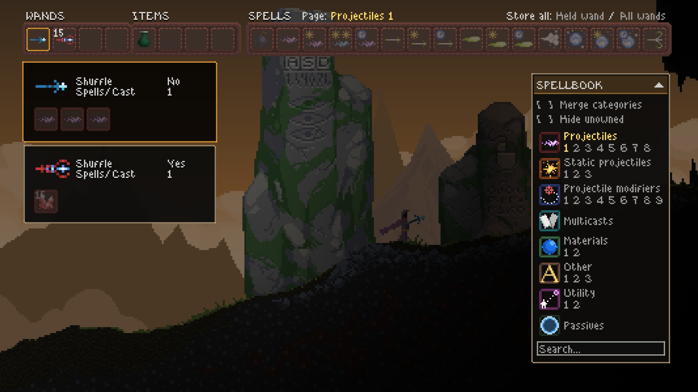

# Spellbook

**Unlimited spell storage for Noita, right in the inventory's own spell row.**

No new controls to learn: the spell row shows a page of your spells as real cards, and you move
them with the game's own drag-and-drop.

## Features

**Every spell, stored.** Spells you pick up go straight into the spellbook, even with the
inventory closed. Drag one into a wand to take it; drag it back to store it.
<!--  -->

**A table of contents.** The SPELLBOOK panel lists every page by spell type. Sweep the mouse down
it to flick through the pages; click one to stay there.
<!--  -->

**Copies stack.** One slot per spell, with a count. Take one and the next copy takes its place.
<!--  -->

**Pick the exact copy.** Right-click a limited-use spell to see every copy of it by uses left.
<!--  -->

**Search.** Type part of a name to find a spell.
<!--  -->

**Store all.** In a Holy Mountain, store a whole wand in one click, or double-click a spell to
store just that one.
<!--  -->

Also: spell refreshers refill stored spells, the panel can be moved and collapsed, and everything
is saved with your run.

## Install

- **Steam Workshop:** coming soon.
- **By hand:** download this repository and put it in Noita's `mods` folder as a folder named
  **`spellbook`** (the name matters). Then enable "Spellbook" in the Mods menu.

Turn off other spell storage mods, such as Advanced Spell Inventory. Spells added by other mods
work, in any load order.

## More

Every detail, the settings, troubleshooting and how the code works:
[docs/DETAILS.md](docs/DETAILS.md).

## License

[MIT](LICENSE)
